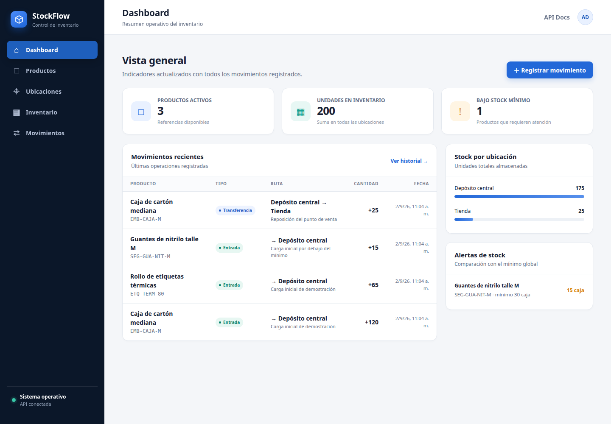
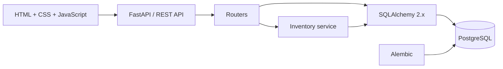
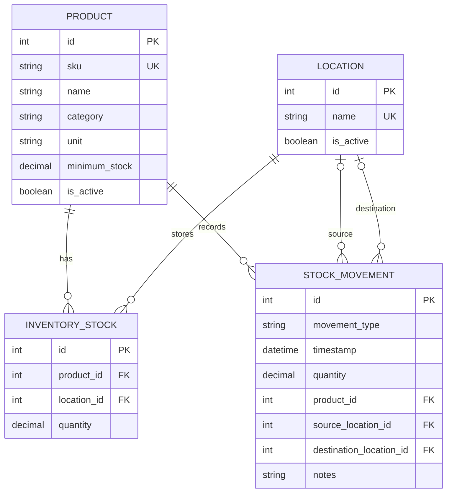

# StockFlow · Inventory Management System


StockFlow is a web application that centralizes products, storage locations, inventory levels, and stock movements. It is designed for small and medium-sized businesses that want to replace disconnected spreadsheets and manual controls with a consistent, traceable source of information.

FastAPI serves both the REST API and the web interface. The frontend uses plain HTML, CSS, and vanilla JavaScript, with no Node.js dependency or build step.

> **Status:** functional portfolio project prepared for local use and future development. It does not claim real customers, financial results, or production usage.



## Table of contents

- [Business problem](#business-problem)
- [Features](#features)
- [Business rules](#business-rules)
- [Architecture](#architecture)
- [Data model](#data-model)
- [Quick start](#quick-start)
- [Configuration](#configuration)
- [Migrations and demo data](#migrations-and-demo-data)
- [REST API](#rest-api)
- [Testing and CI](#testing-and-ci)
- [Repository structure](#repository-structure)
- [Troubleshooting](#troubleshooting)
- [Roadmap](#roadmap)

## Business problem

Inventory managed through separate spreadsheets makes it difficult to determine how much stock is available, where it is stored, and which operation caused each change. StockFlow addresses these problems with:

- inventory levels per product and location;
- a chronological, immutable movement history;
- validation before inventory is changed;
- consistent transfers between warehouses or stores;
- low-stock alerts based on configurable thresholds;
- a reusable REST API in addition to the web interface.

## Features

| Module | Capabilities |
|---|---|
| Dashboard | Active products, total units, low-stock alerts, recent activity, and stock by location |
| Products | Unique SKU, name, description, category, unit, minimum stock, and status |
| Locations | Warehouses, stores, or other stock points with descriptions and status |
| Inventory | Current quantity per product and location, search, and alert filtering |
| Movements | Entries, exits, adjustments, and transfers with timestamps, locations, and notes |
| API | REST endpoints, request validation, structured errors, and OpenAPI documentation |

The Spanish-language interface includes sidebar navigation, responsive layouts, forms, confirmation prompts, filters, feedback messages, and empty states.

## Business rules

- Inventory can never become negative.
- An exit or negative adjustment requires sufficient available stock.
- A transfer requires different source and destination locations and updates both within one transaction.
- Movements remain in history and cannot be updated or deleted through the API.
- `DELETE` on products and locations performs a logical deactivation instead of physical deletion.
- Inactive products and locations remain queryable but cannot receive new movements.
- SKUs are normalized to uppercase and must be unique.
- Dashboard low-stock status compares the product minimum against its total quantity across locations.

## Architecture

The project uses a compact architecture: routers handle HTTP, Pydantic validates contracts, the inventory service owns transactional business rules, and SQLAlchemy manages persistence.



Stock operations lock the relevant rows with `SELECT ... FOR UPDATE`. Locations are locked in deterministic order to reduce deadlock risk, and any exception rolls back the complete transaction.

### Technology stack

- Python 3.11+
- FastAPI and Uvicorn
- SQLAlchemy 2.x
- PostgreSQL and Psycopg 3
- Alembic
- Pydantic Settings
- Jinja2
- HTML5, CSS3, and vanilla JavaScript
- pytest and HTTPX
- GitHub Actions

## Data model



| Type | Quantity | Source | Destination | Effect |
|---|---:|---|---|---|
| `ENTRY` | Positive | — | Required | Increases destination stock |
| `EXIT` | Positive | Required | — | Decreases source stock |
| `TRANSFER` | Positive | Required | Required | Decreases source and increases destination atomically |
| `ADJUSTMENT` | Positive or negative | — | Required | Corrects stock at one location |

PostgreSQL also enforces constraints for quantities, uniqueness, foreign keys, and valid movement structure.

## Quick start

### Requirements

- Python 3.11 or newer
- PostgreSQL
- Git

### 1. Prepare PostgreSQL

On Ubuntu or Debian:

```bash
sudo apt update
sudo apt install -y python3 python3-venv python3-pip postgresql postgresql-contrib libpq-dev
sudo systemctl enable --now postgresql
sudo -u postgres psql
```

Inside `psql`:

```sql
CREATE USER inventory_user WITH PASSWORD 'inventory_password';
CREATE DATABASE inventory_db OWNER inventory_user;
\q
```

These credentials are intended for local development only. Use different credentials in any shared environment.

### 2. Create the Python environment

Linux or macOS:

```bash
python3 -m venv .venv
source .venv/bin/activate
python -m pip install --upgrade pip
python -m pip install -r requirements.txt
```

Windows PowerShell:

```powershell
py -m venv .venv
.venv\Scripts\Activate.ps1
python -m pip install --upgrade pip
python -m pip install -r requirements.txt
```

### 3. Configure, migrate, and run

Linux or macOS:

```bash
cp .env.example .env
alembic upgrade head
python -m app.seed
python -m uvicorn app.main:app --reload
```

Windows PowerShell:

```powershell
Copy-Item .env.example .env
alembic upgrade head
python -m app.seed
python -m uvicorn app.main:app --reload
```

Open:

- Application: <http://127.0.0.1:8000>
- Swagger UI: <http://127.0.0.1:8000/docs>
- ReDoc: <http://127.0.0.1:8000/redoc>

## Configuration

Configuration is loaded from environment variables and, during local development, from `.env`.

| Variable | Example | Purpose |
|---|---|---|
| `INVENTORY_APP_NAME` | `Inventory Management System` | Application and OpenAPI title |
| `INVENTORY_APP_ENVIRONMENT` | `development` | Environment identifier |
| `INVENTORY_DEBUG` | `false` | FastAPI debug mode |
| `INVENTORY_DATABASE_URL` | `postgresql+psycopg://...` | SQLAlchemy database URL |
| `INVENTORY_RECENT_MOVEMENTS_LIMIT` | `8` | Number of movements shown on the dashboard |

The `INVENTORY_` prefix prevents collisions with generic system variables. The `.env` file is ignored by Git and must never be published.

## Migrations and demo data

The application does not create tables automatically at startup. Alembic is the only source of database schema changes:

```bash
alembic upgrade head
alembic current
```

After changing the SQLAlchemy models:

```bash
alembic revision --autogenerate -m "describe the change"
alembic upgrade head
```

Always review the generated `upgrade` and `downgrade` operations before committing a migration.

Load the generic demonstration dataset with:

```bash
python -m app.seed
```

The seed process is idempotent for catalog records and only inserts its movements when movement history is empty. It does not contain real companies, customers, usage, or financial results.

## REST API

| Method | Endpoint | Description |
|---|---|---|
| `GET`, `POST` | `/api/products` | List or create products |
| `GET`, `PATCH`, `DELETE` | `/api/products/{id}` | Read, update, or deactivate a product |
| `GET`, `POST` | `/api/locations` | List or create locations |
| `GET`, `PATCH`, `DELETE` | `/api/locations/{id}` | Read, update, or deactivate a location |
| `GET` | `/api/inventory` | Query stock levels and filters |
| `GET`, `POST` | `/api/movements` | List or register movements |
| `GET` | `/api/movements/{id}` | Read a historical movement |
| `GET` | `/api/dashboard` | Read metrics and summaries |
| `GET` | `/api/health` | Check basic API status |

Example stock entry:

```bash
curl -X POST http://127.0.0.1:8000/api/movements \
  -H "Content-Type: application/json" \
  -d '{
    "movement_type": "ENTRY",
    "product_id": 1,
    "quantity": 25,
    "destination_location_id": 1,
    "notes": "Goods received"
  }'
```

Business errors contain a readable `detail` and a stable `code`, such as `duplicate_sku` or `insufficient_stock`. Invalid request contracts receive FastAPI's standard `422` response.

## Testing and CI

Install development dependencies and run the test suite:

```bash
python -m pip install -r requirements-dev.txt
pytest
```

The suite covers:

- product creation;
- duplicate SKU rejection;
- stock entries and exits;
- insufficient stock without partial changes;
- transfers between locations;
- low-stock calculation.

Tests use in-memory SQLite and do not modify PostgreSQL. The GitHub Actions workflow runs pytest with Python 3.11, 3.12, 3.13, and 3.14 on every push or pull request targeting `main`.

## Repository structure

```text
.
├── .github/
│   ├── ISSUE_TEMPLATE/         # bug and feature forms
│   ├── workflows/tests.yml     # continuous integration
│   └── pull_request_template.md
├── alembic/
│   ├── versions/               # database revisions
│   └── env.py
├── app/
│   ├── routers/                # REST endpoints by resource
│   ├── services/               # transactional business rules
│   ├── static/                 # CSS and JavaScript
│   ├── templates/              # HTML interface
│   ├── config.py
│   ├── database.py
│   ├── models.py
│   ├── schemas.py
│   ├── seed.py
│   └── main.py
├── docs/images/                # README assets
├── tests/                      # functional test suite
├── .env.example
├── CONTRIBUTING.md
├── CHANGELOG.md
├── requirements.txt            # runtime dependencies
└── requirements-dev.txt        # testing dependencies
```

## Troubleshooting

### `password authentication failed`

The password in `.env` does not match the PostgreSQL role. For a local environment using the example values:

```bash
sudo -u postgres psql -c "ALTER ROLE inventory_user WITH LOGIN PASSWORD 'inventory_password';"
```

### `relation ... does not exist`

Confirm that `.env` points to the intended database and apply migrations before startup:

```bash
alembic current
alembic upgrade head
```

### `relation "products" already exists`

The database contains a previous schema that is not managed by these migrations. Use an empty PostgreSQL database or migrate the existing data explicitly. Do not mark the revision as applied unless the complete schema matches.

### The interface shows “No pudimos cargar la información”

The interface loaded, but an API endpoint returned an error. Check the traceback in the Uvicorn terminal and open <http://127.0.0.1:8000/api/health>.

## Contributing

See [CONTRIBUTING.md](CONTRIBUTING.md) for environment setup, test expectations, and pull request guidance. Bug reports and feature proposals have dedicated forms under `.github/ISSUE_TEMPLATE`.

## Roadmap

- authentication and role-based access;
- operator identity on every movement;
- suppliers, purchase orders, and partial receipts;
- reservations and available-stock calculations;
- minimum levels per product and location;
- validated CSV imports;
- exportable reports and barcode support;
- PostgreSQL integration tests;
- observability and deployment guidance.

## License

This repository does not currently declare a license. The owner should choose and add a license before granting reuse or distribution rights.
