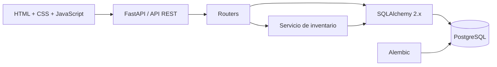
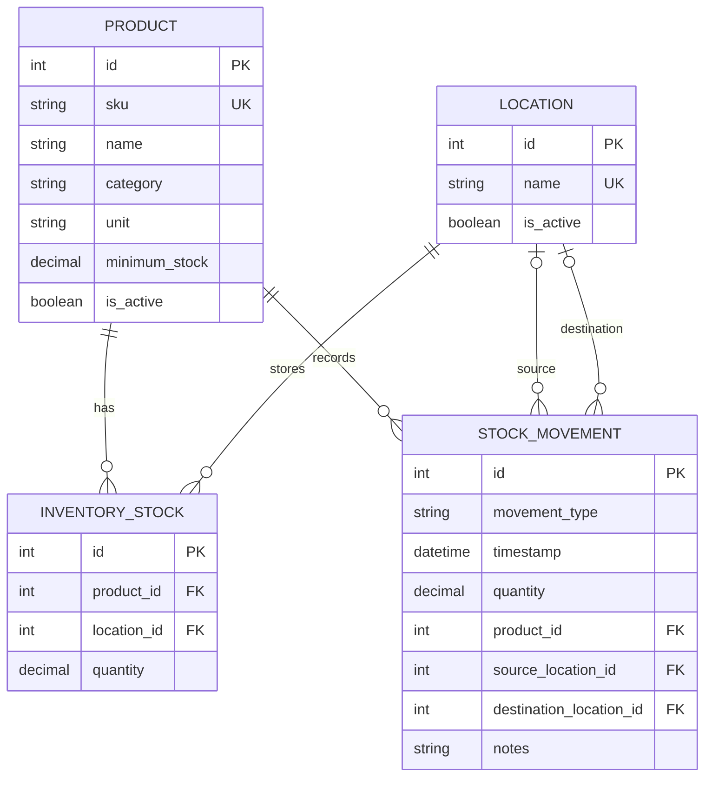

# StockFlow · Sistema de Gestión de Inventario


Aplicación web para centralizar productos, ubicaciones, existencias y movimientos de inventario. Está orientada a pequeñas y medianas organizaciones que desean reemplazar hojas de cálculo y controles manuales por una fuente de información consistente y trazable.

FastAPI sirve la API REST y la interfaz web. El frontend está construido con HTML, CSS y JavaScript nativo, sin Node.js ni un proceso de compilación.

> **Estado:** versión funcional de portafolio, preparada para ejecución local y evolución. No representa uso, clientes ni resultados de producción.


## Contenido

- [Qué resuelve](#qué-resuelve)
- [Funcionalidades](#funcionalidades)
- [Reglas de negocio](#reglas-de-negocio)
- [Arquitectura](#arquitectura)
- [Modelo de datos](#modelo-de-datos)
- [Inicio rápido](#inicio-rápido)
- [Configuración](#configuración)
- [Migraciones y datos demo](#migraciones-y-datos-demo)
- [API REST](#api-rest)
- [Pruebas y CI](#pruebas-y-ci)
- [Estructura del repositorio](#estructura-del-repositorio)
- [Solución de problemas](#solución-de-problemas)
- [Próximas mejoras](#próximas-mejoras)

## Qué resuelve

El control de inventario mediante archivos Excel separados dificulta saber cuánto stock existe, dónde está y qué operación produjo cada cambio. StockFlow concentra estas responsabilidades en una aplicación con:

- existencias por producto y ubicación;
- historial cronológico e inmutable de operaciones;
- validaciones antes de afectar stock;
- transferencias consistentes entre depósitos o tiendas;
- alertas sobre productos por debajo de su mínimo;
- una API reutilizable además de la interfaz web.

## Funcionalidades

| Módulo | Capacidades |
|---|---|
| Dashboard | Productos activos, unidades totales, alertas de mínimo, actividad reciente y stock por ubicación |
| Productos | SKU único, nombre, descripción, categoría, unidad, mínimo y estado |
| Ubicaciones | Depósitos, tiendas u otros puntos de stock con descripción y estado |
| Inventario | Cantidad actual por combinación de producto y ubicación, búsqueda y filtro de alertas |
| Movimientos | Entradas, salidas, ajustes y transferencias con fecha, ubicaciones y notas |
| API | Endpoints REST, validación de contratos y documentación OpenAPI |

La interfaz incluye navegación lateral, diseño responsive, formularios, confirmaciones, filtros, mensajes de resultado y estados vacíos.

## Reglas de negocio

- El stock nunca puede quedar negativo.
- Una salida o ajuste negativo requiere disponibilidad suficiente.
- Una transferencia exige ubicaciones diferentes y actualiza origen y destino en una sola transacción.
- Los movimientos permanecen en el historial y no tienen endpoints de modificación o eliminación.
- `DELETE` sobre productos y ubicaciones realiza una desactivación lógica; no elimina información histórica.
- Los productos o ubicaciones inactivos siguen siendo consultables, pero no admiten movimientos nuevos.
- El SKU se normaliza a mayúsculas y es único.
- El mínimo del dashboard se calcula sobre el stock total del producto en todas las ubicaciones.

## Arquitectura

El proyecto usa una arquitectura compacta: las rutas se ocupan de HTTP, Pydantic valida contratos, el servicio de inventario contiene las reglas transaccionales y SQLAlchemy administra la persistencia.



Las operaciones de stock bloquean las filas involucradas con `SELECT ... FOR UPDATE`. Las ubicaciones se bloquean en orden determinista para reducir interbloqueos, y cualquier excepción revierte la transacción completa.

### Tecnologías

- Python 3.11+
- FastAPI y Uvicorn
- SQLAlchemy 2.x
- PostgreSQL y Psycopg 3
- Alembic
- Pydantic Settings
- Jinja2
- HTML5, CSS3 y JavaScript nativo
- pytest y HTTPX
- GitHub Actions

## Modelo de datos



| Tipo | Cantidad | Origen | Destino | Efecto |
|---|---:|---|---|---|
| `ENTRY` | Positiva | — | Obligatorio | Incrementa el destino |
| `EXIT` | Positiva | Obligatorio | — | Descuenta el origen |
| `TRANSFER` | Positiva | Obligatorio | Obligatorio | Descuenta y suma atómicamente |
| `ADJUSTMENT` | Positiva o negativa | — | Obligatorio | Corrige el stock de la ubicación |

PostgreSQL también aplica restricciones para cantidades, unicidad, claves foráneas y estructura válida de movimientos.

## Inicio rápido

### Requisitos

- Python 3.11 o superior
- PostgreSQL en ejecución
- Git

### 1. Preparar PostgreSQL

En Ubuntu o Debian:

```bash
sudo apt update
sudo apt install -y python3 python3-venv python3-pip postgresql postgresql-contrib libpq-dev
sudo systemctl enable --now postgresql
sudo -u postgres psql
```

Dentro de `psql`:

```sql
CREATE USER inventory_user WITH PASSWORD 'inventory_password';
CREATE DATABASE inventory_db OWNER inventory_user;
\q
```

Las credenciales anteriores son únicamente para desarrollo local. Usa valores diferentes en cualquier entorno compartido.

### 2. Crear el entorno Python

Linux o macOS:

```bash
python3 -m venv .venv
source .venv/bin/activate
python -m pip install --upgrade pip
python -m pip install -r requirements.txt
```

Windows PowerShell:

```powershell
py -m venv .venv
.venv\Scripts\Activate.ps1
python -m pip install --upgrade pip
python -m pip install -r requirements.txt
```

### 3. Configurar, migrar y ejecutar

Linux o macOS:

```bash
cp .env.example .env
alembic upgrade head
python -m app.seed
python -m uvicorn app.main:app --reload
```

Windows PowerShell:

```powershell
Copy-Item .env.example .env
alembic upgrade head
python -m app.seed
python -m uvicorn app.main:app --reload
```

Abre en el navegador:

- Aplicación: <http://127.0.0.1:8000>
- Swagger UI: <http://127.0.0.1:8000/docs>
- ReDoc: <http://127.0.0.1:8000/redoc>

## Configuración

La configuración se carga desde variables de entorno y, durante el desarrollo, desde `.env`.

| Variable | Valor de ejemplo | Propósito |
|---|---|---|
| `INVENTORY_APP_NAME` | `Sistema de Gestión de Inventario` | Nombre de la aplicación y de OpenAPI |
| `INVENTORY_APP_ENVIRONMENT` | `development` | Identificador del entorno |
| `INVENTORY_DEBUG` | `false` | Modo de depuración de FastAPI |
| `INVENTORY_DATABASE_URL` | `postgresql+psycopg://...` | URL de conexión de SQLAlchemy |
| `INVENTORY_RECENT_MOVEMENTS_LIMIT` | `8` | Movimientos visibles en el dashboard |

El prefijo `INVENTORY_` evita colisiones con variables genéricas del sistema. `.env` está ignorado por Git y nunca debe publicarse.

## Migraciones y datos demo

La aplicación no crea tablas automáticamente al iniciar. Alembic es la única fuente de evolución del esquema:

```bash
alembic upgrade head
alembic current
```

Después de modificar modelos:

```bash
alembic revision --autogenerate -m "descripcion del cambio"
alembic upgrade head
```

Revisa siempre las operaciones `upgrade` y `downgrade` antes de confirmar una migración.

Para cargar datos genéricos de demostración:

```bash
python -m app.seed
```

El seed es idempotente para catálogos y solo agrega sus movimientos cuando el historial está vacío. No contiene empresas, clientes ni resultados reales.

## API REST

| Método | Endpoint | Descripción |
|---|---|---|
| `GET`, `POST` | `/api/products` | Listar o crear productos |
| `GET`, `PATCH`, `DELETE` | `/api/products/{id}` | Consultar, actualizar o desactivar un producto |
| `GET`, `POST` | `/api/locations` | Listar o crear ubicaciones |
| `GET`, `PATCH`, `DELETE` | `/api/locations/{id}` | Consultar, actualizar o desactivar una ubicación |
| `GET` | `/api/inventory` | Consultar existencias y filtros |
| `GET`, `POST` | `/api/movements` | Consultar o registrar movimientos |
| `GET` | `/api/movements/{id}` | Consultar un movimiento histórico |
| `GET` | `/api/dashboard` | Obtener métricas y resúmenes |
| `GET` | `/api/health` | Comprobar el estado básico de la API |

Ejemplo de entrada de stock:

```bash
curl -X POST http://127.0.0.1:8000/api/movements \
  -H "Content-Type: application/json" \
  -d '{
    "movement_type": "ENTRY",
    "product_id": 1,
    "quantity": 25,
    "destination_location_id": 1,
    "notes": "Recepción de mercadería"
  }'
```

Los errores de negocio incluyen un mensaje `detail` y un `code` estable, como `duplicate_sku` o `insufficient_stock`. Los contratos inválidos reciben la respuesta estándar `422` de FastAPI.

## Pruebas y CI

Instala las dependencias de desarrollo y ejecuta la suite:

```bash
python -m pip install -r requirements-dev.txt
pytest
```

La suite cubre:

- creación de productos;
- rechazo de SKU duplicado;
- entradas y salidas;
- stock insuficiente sin cambios parciales;
- transferencias entre ubicaciones;
- cálculo de productos bajo mínimo.

Las pruebas usan SQLite en memoria y no modifican PostgreSQL. El workflow de GitHub Actions ejecuta pytest con Python 3.11, 3.12, 3.13 y 3.14 en cada push o pull request dirigido a `main`.

## Estructura del repositorio

```text
.
├── .github/
│   ├── ISSUE_TEMPLATE/         # formularios de errores y mejoras
│   ├── workflows/tests.yml     # integración continua
│   └── pull_request_template.md
├── alembic/
│   ├── versions/               # revisiones de base de datos
│   └── env.py
├── app/
│   ├── routers/                # endpoints por recurso
│   ├── services/               # reglas transaccionales
│   ├── static/                 # CSS y JavaScript
│   ├── templates/              # interfaz HTML
│   ├── config.py
│   ├── database.py
│   ├── models.py
│   ├── schemas.py
│   ├── seed.py
│   └── main.py
├── docs/images/                # recursos del README
├── tests/                      # pruebas funcionales
├── .env.example
├── CONTRIBUTING.md
├── CHANGELOG.md
├── requirements.txt            # ejecución
└── requirements-dev.txt        # pruebas y desarrollo
```

## Solución de problemas

### `password authentication failed`

La contraseña en `.env` no coincide con la del rol PostgreSQL. Para un entorno local con los valores de ejemplo:

```bash
sudo -u postgres psql -c "ALTER ROLE inventory_user WITH LOGIN PASSWORD 'inventory_password';"
```

### `relation ... does not exist`

Confirma que `.env` apunte a la base correcta y aplica la migración antes de iniciar:

```bash
alembic current
alembic upgrade head
```

### `relation "products" already exists`

La base contiene un esquema previo no administrado por estas migraciones. Usa una base PostgreSQL vacía o migra esos datos explícitamente; no marques la revisión como aplicada sin comprobar que todo el esquema coincide.

### La interfaz muestra “No pudimos cargar la información”

La interfaz se sirvió, pero un endpoint devolvió un error. Revisa el traceback en la terminal de Uvicorn y prueba <http://127.0.0.1:8000/api/health>.

## Contribución

Consulta [CONTRIBUTING.md](CONTRIBUTING.md) para preparar el entorno, ejecutar pruebas y abrir cambios. Los reportes de errores y propuestas cuentan con plantillas dentro de `.github/ISSUE_TEMPLATE`.

## Próximas mejoras

- autenticación y permisos por rol;
- identidad del operador en cada movimiento;
- proveedores, compras y recepciones parciales;
- reservas y stock disponible;
- mínimos específicos por producto y ubicación;
- importación validada desde CSV;
- reportes exportables y lectura de códigos de barras;
- pruebas de integración contra PostgreSQL;
- observabilidad y estrategia de despliegue.

## Licencia

El repositorio aún no declara una licencia. Antes de permitir reutilización o distribución, el propietario debe elegir y agregar una licencia acorde con sus objetivos.
# inventory_system
